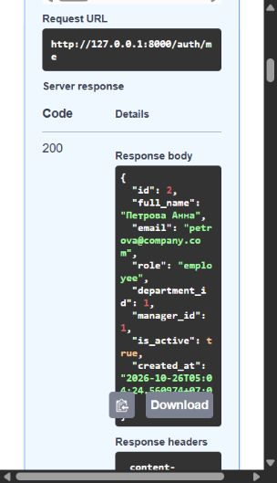

# Проверка HR-портала

Проверено 26 октября 2026 года. Ошибка авторизации исправлена. Функциональные сценарии ИПР и требуемые CRUD-операции работают в исправленной версии. Полного соответствия всем нефункциональным пунктам ТЗ не заявляю: ограничения проверки перечислены ниже.

Исходные архивы и дамп не изменялись. Рабочая копия присланного дампа восстановлена в отдельную PostgreSQL 18.6 на 127.0.0.1:55432. Новая демонстрационная база, базы тестов и проверка восстановления изолированы от пользовательской hr_ipr.

## Основания проверки

Использованы Practice_03_Backend_Setup.pptx, Practice_04_CRUD_API.pptx, Описание проекта.docx из архива, DBML, исходный SQL, исходный код и присланный hr_ipr_backup.sql. Документы использованы как требования и исходные данные.

Практика 3 требует окружение FastAPI, подключение PostgreSQL, все ORM-модели, ключи и связи. Практика 4 требует полный CRUD для 2–3 сущностей, Pydantic-схемы, пагинацию, проверки существования, Swagger и экспорт коллекции Postman. В исправленной версии полный CRUD есть у компетенций, ИПР, целей и мероприятий. Отделы доступны только для чтения в соответствии с границами проектного ТЗ.

## Почему после входа всё переставало работать

В исходном POST /auth/login создавался JWT с числовым sub: 93. python-jose отвергал его при следующем запросе: Subject must be a string. Вход возвращал 200, а GET /development-plans/ с выданным токеном — 401.

Теперь sub записывается строкой, при чтении проверяется и преобразуется в идентификатор пользователя. Проверяются подпись, срок действия, существование и активность пользователя. Это соответствует [RFC 7519, раздел 4.1.2](https://www.rfc-editor.org/rfc/rfc7519.html#section-4.1.2).

| Запрос | Исходная версия | Исправленная версия |
|---|---:|---:|
| POST /auth/login с правильным паролем | 200 | 200 |
| GET /development-plans/ с выданным токеном | 401 | 200 |
| GET /development-plans/ без входа | 401 | 401 |
| GET /competencies/ без входа | 401 | 401 |
| GET /departments/ без входа | 200 | 401 |

Утверждение, что все функции открыты без авторизации, на присланном исходнике не воспроизвелось. Возможны запуск другой копии проекта или ранее сохранённый токен Swagger. Это гипотезы, а не установленная причина.

## Исправленные ошибки

- Разделены права на чтение и изменение ИПР: руководитель просматривает чужой план, а содержание меняет только владелец.
- Удалён обход согласования через PATCH со status или manager_comment. Статусы меняются только предусмотренными операциями.
- В PATCH ИПР добавлены даты, которые раньше отсутствовали во входной схеме. Изменение периода и срока цели повторно проверяет дочерние сроки.
- Исправлены ответы: возвращаются цели, мероприятия, уровни компетенций, прогресс и вычисляемое выполнение цели.
- POST цели и мероприятия возвращают их ID. Добавлены недостающие GET и PUT, чтение компетенции по ID и изменение уровней в плане.
- Статический /pending-count зарегистрирован раньше /{plan_id}; вместо ошибочного разбора строки как ID возвращается счётчик.
- Самосогласование, действия чужого руководителя и изменение согласованного содержания запрещены.
- Просроченное мероприятие можно завершить, но дата выполнения не может быть раньше начала ИПР или в будущем.
- Последнее мероприятие и завершение ИПР сохраняются одной транзакцией. Изменения ИПР блокируют его строку до окончания транзакции.
- Добавлены ограничения пагинации: по умолчанию 20, максимум 100, отрицательные значения запрещены.
- Устранены дубли маршрута / и расхождения дублирующих схем.
- Исправлен requirements.txt: перечислены фактически нужные зависимости авторизации, форм, PostgreSQL и миграций.
- Миграции читают подключение из .env и создают схему на пустой базе. ORM и новая схема содержат CHECK и индексы из проектной модели.
- Наполнение согласовано с моделью. Павлова имеет роль hr. Повторный обычный запуск seed не стирает существующие данные.
- Поддержаны bcrypt из текущего дампа и PBKDF2 из исходного SQL практик 1–2.

## Функциональное ТЗ

| Пункт описания проекта | Результат |
|---|---|
| 1. Вход по email и паролю, ИПР закрыты без входа | Проверено |
| 2. Список своих ИПР и детали с содержимым | Проверено |
| 3. Создание и редактирование своего черновика | Проверено |
| 4. Удаление только draft, каскадное удаление | Проверено |
| 5. Компетенции, уровни 1–5, запрет дубля | Проверено |
| 6. Отправка заполненного ИПР действующему руководителю | Проверено |
| 7. Прямые подчинённые, свои планы, фильтр pending | Проверено |
| 8. Утверждение и отклонение с комментарием | Проверено |
| 9. Возврат rejected в draft с сохранением комментария | Проверено |
| 10. Выполнение мероприятия только владельцем approved-плана | Проверено |
| 11. Прогресс и вычисляемое состояние цели | Проверено |
| 12. Автоматическое completed после последнего мероприятия | Проверено |
| 13. Справочник компетенций для HR, запрет удаления используемой | Проверено |
| 14. Проверка доступа при запросах, запрет самосогласования | Проверено |

Изменение руководителя учитывается при новом решении по pending-плану. Деактивированный пользователь не входит и не появляется в доступных руководителю планах. Руководитель и HR имеют права сотрудника для собственных ИПР. Бейдж представлен API-счётчиком; визуального интерфейса бейджа нет.

## Ошибки старого наполнения

По состоянию на 26.10.2026 скрипт check_data.py обнаружил в присланном дампе:

| Проверка | Результат |
|---|---|
| Пользователи HR | 0; Павлова имеет manager |
| Типы мероприятий вне course/practice/reading | ID 28, 29, 30 |
| Статусы мероприятий вне planned/completed | ID 27, 29 |
| Даты выполнения в будущем | ID 26, 30 |
| Срок цели за периодом ИПР | ID 29 |
| Незаполненные планы в pending | ID 63, 70 |
| Некорректный completed-план без нужного содержимого | ID 65 |
| CHECK-ограничения в public | 0 |

Эти данные не исправлялись автоматически. Для сохранения собственной базы достаточно исправленного кода; для HR есть отдельный SQL scripts/set_demo_hr.sql. Это не исправляет остальные старые данные и не добавляет ограничения в уже существующую схему.

Для демонстрации подготовлен новый hr_ipr_demo.sql: 10 отделов, 15 пользователей, 10 компетенций, 10 ИПР, 9 целей, 9 мероприятий и 9 связей план–компетенция. Один черновик намеренно пустой. В новой схеме 18 CHECK-ограничений, в наполнении есть все пять статусов плана и действующая роль HR. Проверка данных не выявила перечисленных нарушений.

## Фактические проверки

- Python 3.12, FastAPI 0.135.3, SQLAlchemy 2.0.49, Pydantic 2.12.5, PostgreSQL 18.6.
- pytest: 64 теста, 0 ошибок. Проверялись вход, ошибочные/истёкшие токены, деактивация, роли, CRUD, вложенные ID, сроки, уровни, переходы статусов и каскадное удаление.
- Смоделирован сбой сохранения последнего мероприятия: после отката и мероприятие, и план сохраняют исходные состояния.
- Коллекция Postman выполнена через Newman 6.2.1 против работающего Uvicorn: 64 запроса, 72 утверждения, 0 ошибок.
- Покрыты все HTTP-операции исправленного API. Подробности запросов и кодов ответов — API_results.json.
- Swagger открыт в браузере, вход выполнен через Authorize, GET /auth/me вернул 200. Снимок — Swagger_authorized.png рядом с отчётом.
- Проверен полный цикл миграций на пустой базе: upgrade, downgrade, повторный upgrade. Создаются семь предметных таблиц и служебная alembic_version.
- Наполнение проверено на новой базе и повторно без сброса.
- Дамп новой демонстрационной базы создан pg_dump и успешно восстановлен через psql -v ON_ERROR_STOP=1 в ещё одну пустую базу. Проверка восстановленных данных прошла.
- Проверка компиляции Python и совместимости установленных зависимостей прошла.

## Что осталось уточнить или подготовить к сдаче

1. В описании проекта соседствуют запрет завершать после срока мероприятия и разрешение завершать просроченное. Реализовано разрешение просрочки с фактической датой от начала ИПР до текущего дня. Предлагаемая формулировка: «Дата выполнения не раньше начала ИПР и не позже текущей даты. Выполнение после планового срока допускается».
2. Нагрузочный норматив «20 пользователей, до 1000 ИПР, 95% запросов до 2 секунд на 4 ядрах и 8 ГБ» не проверялся в таком окружении. Один последовательный локальный прогон Newman не подтверждает этот норматив.
3. Ежедневное резервное копирование с хранением последних семи копий не автоматизировано. Создание и восстановление одной копии проверены.
4. Отдельные скриншоты структуры таблиц в DBeaver/pgAdmin, требуемые практикой 3, не создавались. ER-диаграмма из исходного проекта сохранена, но не заменяет такие скриншоты.
5. Разделение Controller–Service–Repository реализовано частично: бизнес-правила вынесены в сервис, отдельного слоя репозиториев нет. Практическое задание на CRUD выполнено, дальнейшее разделение слоёв остаётся архитектурной доработкой.
6. React-интерфейс не входит в проверенный backend. Визуальная проверка проводилась в Swagger.
7. Для старой базы миграция данных и добавление отсутствующих CHECK потребуют отдельного решения после исправления некорректных записей. Нельзя считать, что замена Python-файлов сама обновляет существующую схему.
8. Скрипт start_portable.ps1 синтаксически проверен. Команды PostgreSQL и Uvicorn проверены отдельно, но скрипт целиком не запускался с исходной пользовательской папкой pgsql/data: она сохранена без изменений.

Коллекция и результаты тестов включены в проект. При переносе используйте чистое окружение Python, а не venv из чужого архива.

